# UML 设计视图

本页描述第一阶段 asr-transcription Skill 的实际对象、调用和状态。第二阶段个性化纪要生成与反馈学习仍在开发中，当前代码尚未实现，不在图中虚构服务。

核对日期：2026-10-27。Python 图中 application、utils 等位置相对于 skills/asr-transcription/scripts/asr_runtime/；frontend 路径相对于仓库根。函数模块使用生命线，具有生命周期的 Session、Runtime、PathPicker 使用对象；状态图描述协议中的状态字符串。

当前协议区分编辑会话 `session_id` 与转写任务 `job_id`：网页填写和预览不产生 `job_id`，用户发送含 `session_id` 的确认消息后才交接。预览展示登记、返回修改、两小时期限及一次结束通知见图 03、07；交接后的认证与执行见图 04、05。持久回执使相同会话恢复同一个任务，网页服务结束不影响执行。

图 03 将填写和预览画为可重复的循环：校验失败或返回修改后，须重新校验并登记当前预览；取消和到期在交接前结束编辑，不产生任务。交接写入配置前按实际任务路径检查完整 Windows 命令，超限保留预览供修改。图 04 的单独凭据保存结束于取消编辑会话，只有已成功交接的任务才进入转写。

图 03 的 HTTP 请求经 web 分派到 Session，终态由 web 的事件请求发送。确认回执与 SSE 来自独立请求线程，图中以并行分支表示，两者没有固定发送顺序。图 07 同时列出主动返回修改和交接检查发现原录音变化时的 preview → editing 转换。

填写或预览期间转去取消、检查更新或安装新 ZIP，先结束本次编辑并等待原服务退出，再保持空闲或进入更新（图03、09）。单独保存凭据后的取消也等待服务退出（图04）。显式取消先保存最小cancelled.json，服务退出后重复cancel仍读取同一结果；旧预览不可交接（图01C、07）。已交接会话返回handed_off，编辑取消不代表云端取消。

图 01A、03、07 还描述关闭与下次开页回收：Session 结束后等请求线程，再清理磁盘；强制退出的旧会话按 PID 与原截止时间回收，保留任务和结果。图 01C 的连接记录给出归属依据，图 04 说明 Key 先在会话目录暂存再替换正式文件。

图 01B 区分数组中的热词单元格、前端稳定行键和显示序号；导入回执只含数组和读取说明，内容问题由预览校验产生。错误绑定稳定行键，编辑或删除只移除当前格或行提示；重复组剩余至少两行时继续标红，仅剩一行时清除重复提示。错误与警告一次返回双语文本，切换语言保留页面状态；关闭增强开关清空相应内容，API Key 保持原样，见图 03。

图 01A、01B、03 同时描述录音附件入口：`serve --audio` 将本次明确的本机路径传入 Session，附件与原生窗口共用 `_register_audio()`。页面读取 `audio` 与双语 `audio_error`，可核对或更换录音；初始文件不可读时继续填写。媒体探测和 SHA 仍在预览时建立，带入文件不创建任务。

图 01C 区分预览设置、已授权配置、交接回执与执行结果。图 02 描述依赖安装，图 06、08 描述本地重导和执行记录失败，这些职责没有迁移到编辑会话。

图 02 区分首次安装与已有运行时：首次使用完整版，由 PowerShell 从包内归档准备私有 Python/Node；已有运行时直接由基础 Python 进入同一依赖安装用例。图 01A 的 Runtime 提供固定绝对路径。后续自动下载轻量包并复用已有运行时；源码安装或显式恢复才使用图中缺少归档的下载分支。自动更新入口从v0.1.2起随正式包提供，图09只在有入口和发行清单的安装中执行；v0.1.0/v0.1.1先按图02通过ZIP重新安装。此发布说明不改变图中的调用或状态，源稿与PNG保持对应。

图 09 描述独立的 Skill 更新入口：按当地日期每日最多检查一次正式版本，已登记的检查失败也记日；仅本次明确要求检查或更新此 Skill 才加 `--check-now`，上下文只补全 Skill 身份。有活动业务命令时暂缓。更新器独占稳定哨兵，用轻量 ZIP 覆盖受管代码和说明，旧清单独有文件删除，最后发布新清单；工作目录不参与覆盖。更新后重读 Skill，依赖准备仍由原安装器处理。

更新入口直接使用基础 Python，不要求虚拟环境就绪，也不传业务入口的 workspace 参数。图 02 区分用户提供 ZIP 的重新安装：完整核对新包后重建已确认的专用资源目录，避免覆盖解压遗留旧实现。图 09 的首次检查记录写入失败返回 `repair_required=false` 和 `record_error`，尚未联网、安装未改；最终记录失败保留实际安装结果，已发布清单仍表示文件更新完成。旧清单、状态、读取保护无法确认或覆盖恢复未完成时返回 `repair_required=true` 和非零退出码，停止业务并修复。

图 09 按本次请求继续：仅检查或更新时，完成相应处理并报告后结束；新转写遇到可恢复更新失败、当天失败缓存、`deferred`、`unmanaged` 或附带记录警告，仍按原环境要求实际执行 `serve`。收到 `event=listening` 后按宿主现有方式请求打开 URL，再交给用户填写；没有可读附件路径时不传 `--audio`。普通 `serve` 的系统打开结果由 `browser_request` 返回，正常路径不追加页面自动检查。

图 01A、01B 同时描述页面版本来源：Runtime 读取当前 `skill-manifest.json` 的 `version`，Session 创建时保存并由 `description()` 返回 `skill_version`，前端显示在品牌旁；源码目录返回 `null`，页面显示“开发版”。

图 02 的平台、venv绑定与依赖检查由同一个目标venv子进程完成，bootstrap与独立doctor共用该探针。图 09 明确日检缓存只代表共享Skill文件；工作目录尚未确认匹配当前Skill时先准备依赖，成功后不额外运行doctor。

升级请求通过bootstrap的cleanup-old-cache选项触发准备成功后的旧下载缓存清理，实际安装了依赖或BL时也执行；图02/09保留当前锁对应缓存、未知npm键及所有业务数据。正常环境复用不增加缓存扫描。

图 02 复制 npm 清单和锁文件，安装官方 BL、core、commands、runtime `2.5.1`。图 04 直接由官方 BL 打开系统默认浏览器并处理授权回调。图 05 由同一 BL 进程完成临时上传、提交、轮询与结果下载：上传遵循3600秒 timeout，凭证请求保持15秒，轮询预算3600秒；Python 整体进程上限7500秒。各时限不是云端完成保证，失败保留一次执行占用。

Python 依赖与百炼 CLI（BL）分别比较各自两个固定下载来源。Python 由 pip 处理有限续传；BL 由 npm 处理连接重试、缓存和完整性校验，仅在已识别的下载错误后换源。本机安装、权限及锁错误停止；安装恢复不改变识别任务的一次执行约束。

编辑时的右侧 SettingsSummary.vue 仅由当前表单派生显示，不产生新的 HTTP 请求或预览版本；正式预览与交接仍按图 03、07 执行。校验期间暂时禁用表单编辑，保留全部输入值；明确重查时替换旧诊断，连接不可用时统一为一个结果页。

源稿为 Mermaid，PNG 供直接阅读。图和开发文档保留在仓库；两个发行包共用运行代码、参考资料和最新版双语 README，完整包另含两个官方运行时 ZIP。图稿及实际渲染验证见 [ACCEPTANCE](ACCEPTANCE.md)。

渲染沿用现有风格：泳道与状态图使用 Mermaid neutral、微软雅黑、白色背景和细灰线；01C保留浅蓝灰类图，主题参数随源稿保存，PNG采用1.5倍像素密度。流程调整只更新内容，不另换主题或配色。

| 视图 | 图像 | 可编辑源稿 |
| --- | --- | --- |
| 01A 对象职责与依赖 | [查看](uml/01-classes.png) | [源码](uml/01-classes.mmd) |
| 01B 共享数据与进程契约 | [查看](uml/01b-data.png) | [源码](uml/01b-data.mmd) |
| 01C 确认配置与交付回执 | [查看](uml/01c-protocol.png) | [源码](uml/01c-protocol.mmd) |
| 02 准备工作目录 | [查看](uml/02-install.png) | [源码](uml/02-install.mmd) |
| 03 本机配置 | [查看](uml/03-configure.png) | [源码](uml/03-configure.mmd) |
| 04 凭据来源与登录 | [查看](uml/04-auth.png) | [源码](uml/04-auth.mmd) |
| 05 转写与交付 | [查看](uml/05-transcribe.png) | [源码](uml/05-transcribe.mmd) |
| 06 重新导出与状态查询 | [查看](uml/06-export.png) | [源码](uml/06-export.mmd) |
| 07 本地状态 | [查看](uml/07-state.png) | [源码](uml/07-state.mmd) |
| 08 记录保存失败 | [查看](uml/08-failure.png) | [源码](uml/08-failure.mmd) |
| 09 Skill 自动更新 | [查看](uml/09-update.png) | [源码](uml/09-update.mmd) |

## 01A 对象职责与依赖

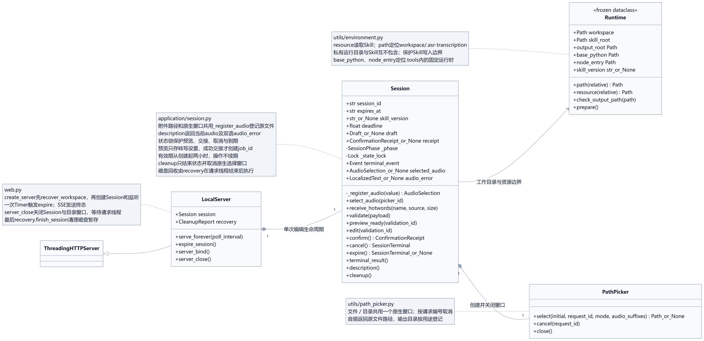

## 01B 共享数据与进程契约

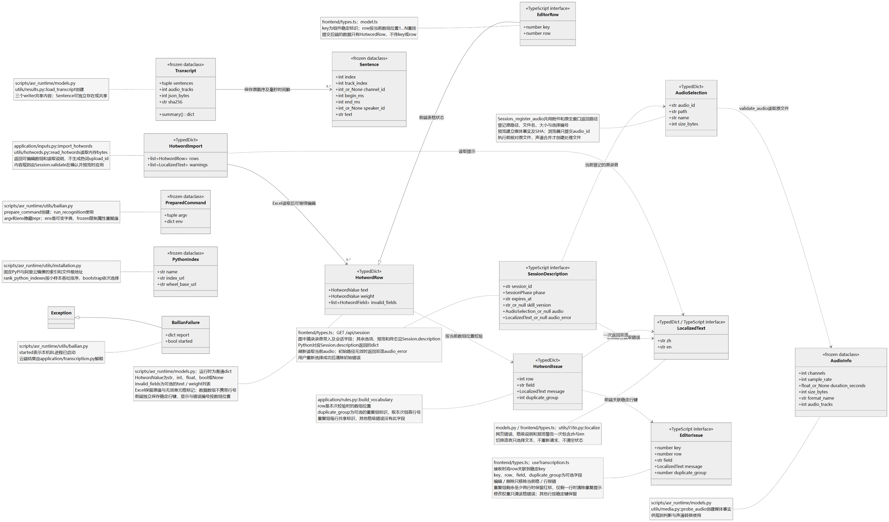

## 01C 确认配置与交付回执

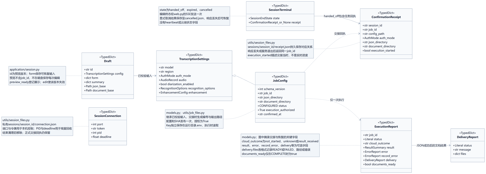

## 02 准备工作目录

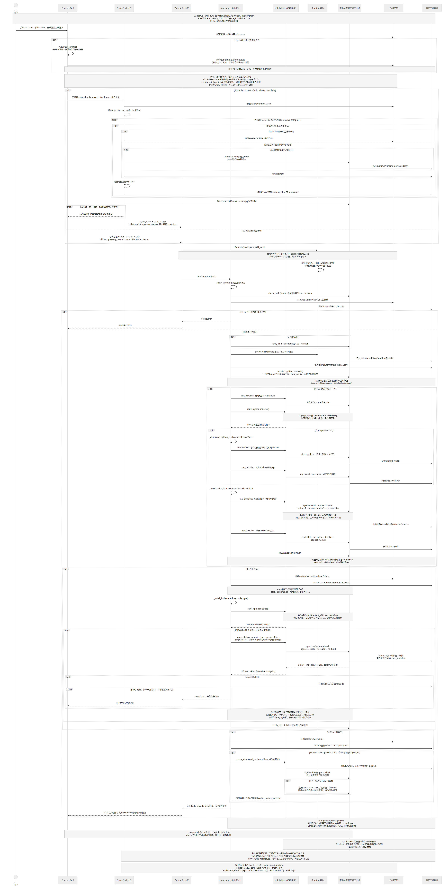

## 03 本机配置

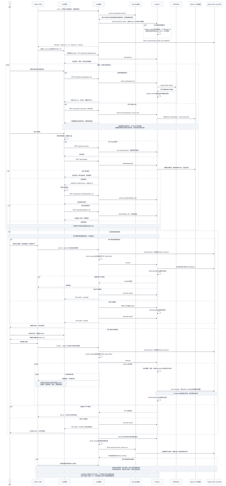

## 04 凭据来源与登录

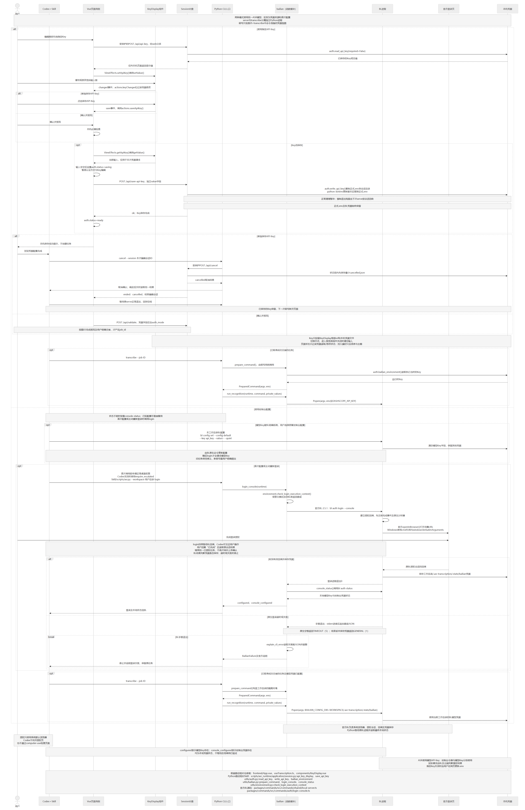

## 05 转写与交付

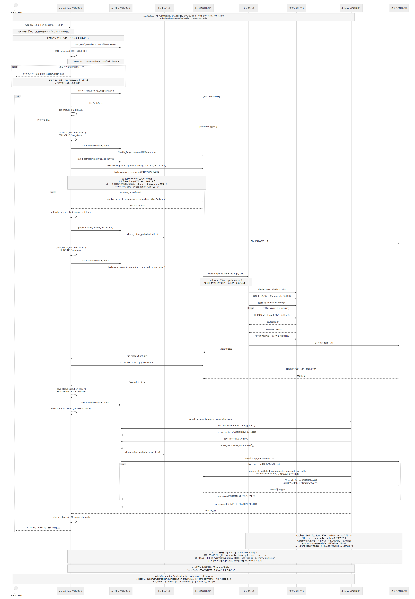

## 06 重新导出与状态查询

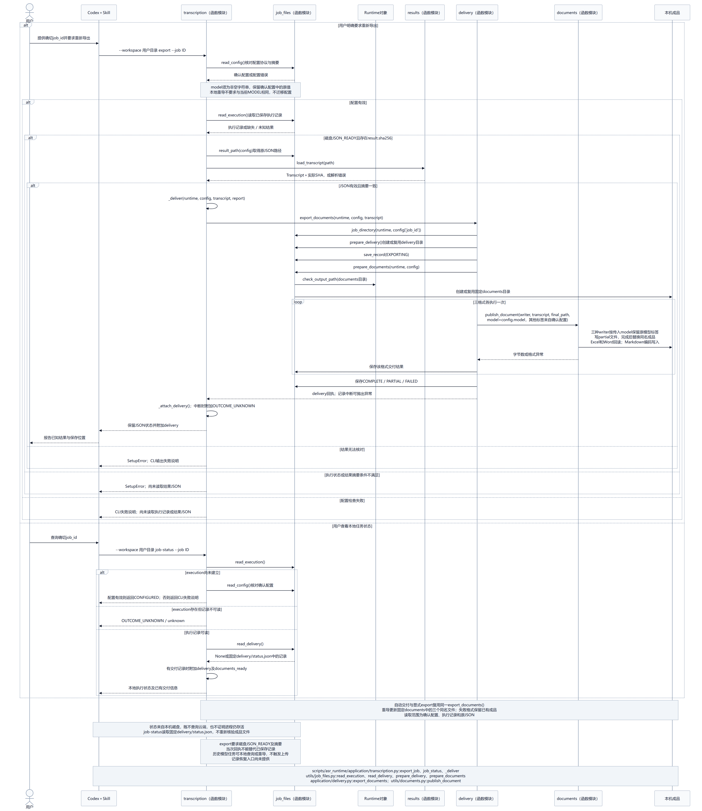

## 07 本地状态

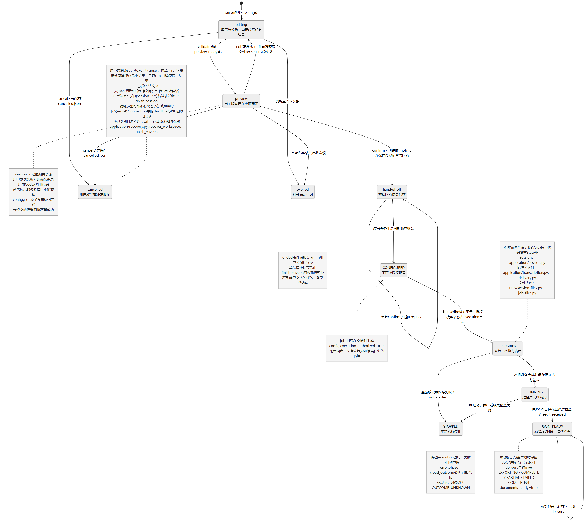

## 08 记录保存失败

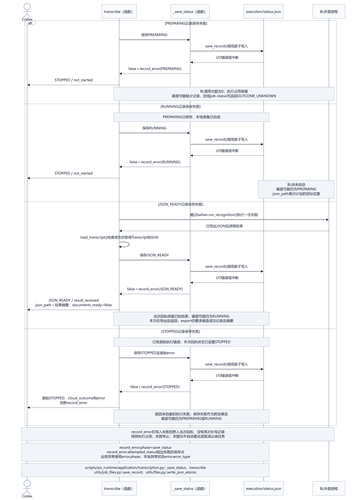

## 09 Skill 自动更新

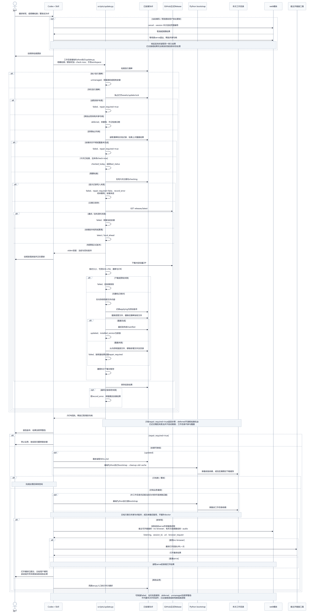
