# UML 设计视图

图稿描述第一阶段 asr-transcription 的实际对象、调用与状态。第二阶段个性化纪要生成及反馈学习尚未实现，不在图中预设服务。

源码是实现与完整字段的权威。类图摘录关键字段；TypedDict 和 TypeScript interface 表示数据协议，函数模块使用生命线，Session、ReviewSession、Runtime、PathPicker及HTTP服务器表示实际对象。Python 路径相对于 `skills/asr-transcription/scripts/asr_runtime/`，前端路径相对于仓库根。

## 按问题选择图稿

| 视图 | 关注边界与对应实现 | 图像 / 源稿 |
| --- | --- | --- |
| 01A 对象职责与依赖 | 配置/回听服务器、Session/ReviewSession、Runtime、PathPicker与共享HTTP边界 | [PNG](uml/01-classes.png) / [Mermaid](uml/01-classes.mmd) |
| 01B 共享数据与进程契约 | `models.py`、`frontend/types.ts`；音频、热词、双语诊断与转写结果 | [PNG](uml/01b-data.png) / [Mermaid](uml/01b-data.mmd) |
| 01C 确认配置与交付回执 | 配置、交接、取消、执行结果，以及独立校对草稿与导出版本 | [PNG](uml/01c-protocol.png) / [Mermaid](uml/01c-protocol.mmd) |
| 02 准备工作目录 | `bootstrap.ps1`、`asr.py`、`application/bootstrap.py`、`utils/installation.py` | [PNG](uml/02-install.png) / [Mermaid](uml/02-install.mmd) |
| 03 本机配置 | `web.py`、Session、recovery、前端用例；填写、预览、交接与退出 | [PNG](uml/03-configure.png) / [Mermaid](uml/03-configure.mmd) |
| 04 凭据来源与登录 | KeyDisplay、`utils/auth.py`、`utils/bailian.py`；本机Key与官方BL登录 | [PNG](uml/04-auth.png) / [Mermaid](uml/04-auth.mmd) |
| 05 转写与交付 | `application/transcription.py`、delivery、BL与文档writer | [PNG](uml/05-transcribe.png) / [Mermaid](uml/05-transcribe.mmd) |
| 06 重新导出与状态查询 | `export_job()`、`job_status()`与本机记录，不调用云端 | [PNG](uml/06-export.png) / [Mermaid](uml/06-export.mmd) |
| 07 转写流程（泳道） | 用户、Codex、本机工具、百炼的职责；会话交接、一次执行、原稿交付及已确认的回听开关 | [PNG](uml/07-workflow.png) / [Mermaid](uml/07-workflow.mmd) |
| 08 记录保存失败 | `_save_status()`失败时的当次回执、磁盘状态与停止位置 | [PNG](uml/08-failure.png) / [Mermaid](uml/08-failure.mmd) |
| 09 Skill 自动更新 | `scripts/update.py`、共享读取保护及Codex后续分派 | [PNG](uml/09-update.png) / [Mermaid](uml/09-update.mmd) |
| 10 人工回听与校验稿 | `review_web.py`、ReviewSession、useReview；音频Range、版本保存、选目录导出及页面在场连接 | [PNG](uml/10-review.png) / [Mermaid](uml/10-review.mmd) |
| 11 回听与校验稿状态 | 浏览器保存状态、ReviewSession关闭与review导出版本，独立于原任务 | [PNG](uml/11-review-state.png) / [Mermaid](uml/11-review-state.mmd) |

`session_id` 定位编辑会话，`job_id` 定位已交接任务。图03/07中的预览不是执行授权；交接失败发现原录音变化或命令过长时保留预览，经既有“返回修改”退出后重新检查。成功交接以原子发布的 `config.json` 为完成标记；会话的handed_off关联新任务，不是同一对象转入执行状态。

图07是四职责泳道的主流程，百炼泳道包含官方BL与云端ASR；节点中的状态用于定位步骤，不是跨对象的状态转换。图03、05说明具体调用，记录保存异常见图08，回听保存与导出状态见图11。配置中的status始终为CONFIGURED；`job-status`在execution尚不存在且配置有效时派生CONFIGURED，已有execution目录但记录缺失或不可读时合成OUTCOME_UNKNOWN。磁盘快照可能滞后，不能据PREPARING、RUNNING或EXPORTING认定进程仍存活。

HTTP控制回执与SSE由不同请求线程发送，没有固定先后。显式取消先保存 `cancelled.json`，再设置终态事件；Codex取得结果后等待原serve退出。图04省略了HTTP分派生命线，事件发送仍由web完成。会话结束与任务执行是两个生命周期，编辑取消不表示云端取消。

图10/11的人工回听复用已完成任务的job_id，草稿保存为任务JSON，Cookie只认证；它不回到图03的预览，也不再次调用图05的BL。校验稿直接写到用户本次选择的目录，取消选择不导出。最后页面断开且10秒内无重连时服务收尾，刷新或其他页面连接会保留服务；代码关闭仍不能提交浏览器尚未保存的输入。`review.delivery`及export_revision表示校验稿，原稿documents_ready含义保持。

状态字段、恢复操作和运行限制分别维护在 [errors.md](../skills/asr-transcription/references/errors.md)、[DEVELOPMENT](DEVELOPMENT.md) 与 [ISSUES](ISSUES.md)，不在此复制完整说明。已执行验证见 [ACCEPTANCE](ACCEPTANCE.md)。

## 统一渲染

受管入口为 [scripts/render_uml.ts](../scripts/render_uml.ts)，唯一主题为 [uml/theme.json](uml/theme.json)。全部图沿用已有浅蓝灰风格、微软雅黑、白色背景与1.5倍像素密度；主题只使用Mermaid公开参数，不在单张图里覆盖。Mermaid固定为开发依赖11.12.0，tsx和Playwright使用根锁文件版本，浏览器为本机Microsoft Edge。

在已有开发环境的仓库根运行：

```powershell
npm ci
npm run check:uml
npm run render:uml
# 仅重建受影响图稿，图名也可带.mmd后缀：
npm run render:uml -- 03-configure 07-workflow
```

入口只从本项目依赖和共享主题读取，不回退 `.runtime`、其他缓存或另一套配色。依赖、主题或Edge缺失，以及Mermaid解析失败时，命令明确失败。未知图名也会报错。

每张图保存PNG前检查全部SVG文字与foreignObject边界；输出该图PNG的实际尺寸和文字节点数。边界检查不代表没有重叠或足够易读，修改后仍需查看整图与相关局部。PNG是由对应 `.mmd` 和共享主题生成的阅读产物；修改图稿或主题后重新运行入口，连同PNG一起审阅。

## 图像

### 01A 对象职责与依赖

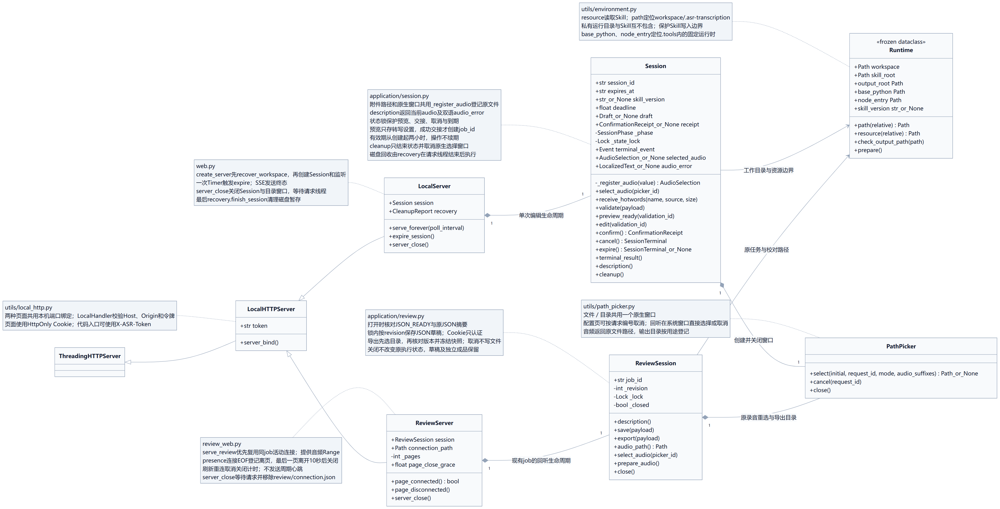

### 01B 共享数据与进程契约

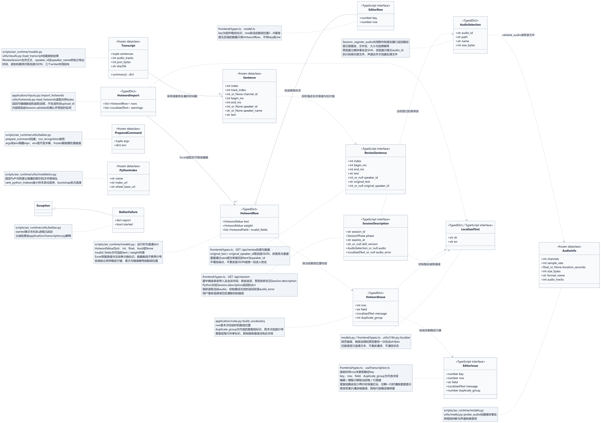

### 01C 确认配置与交付回执

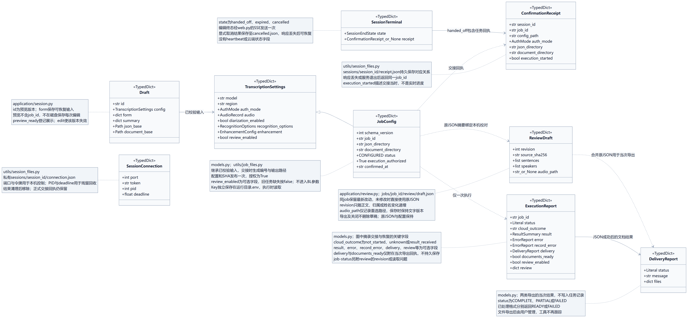

### 02 准备工作目录

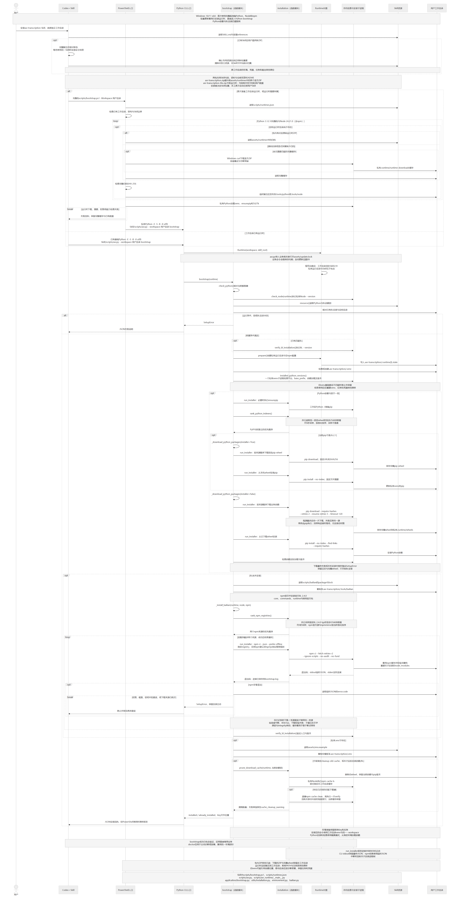

### 03 本机配置

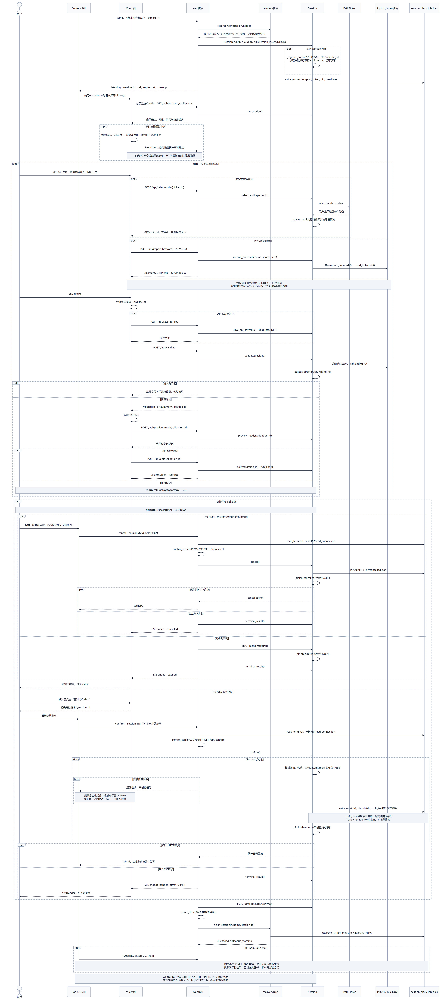

### 04 凭据来源与登录

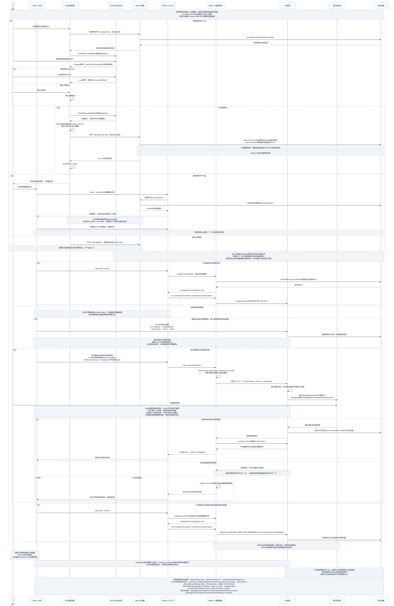

### 05 转写与交付

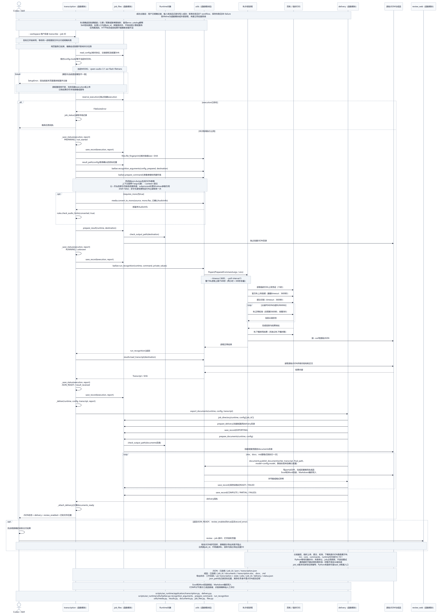

### 06 重新导出与状态查询

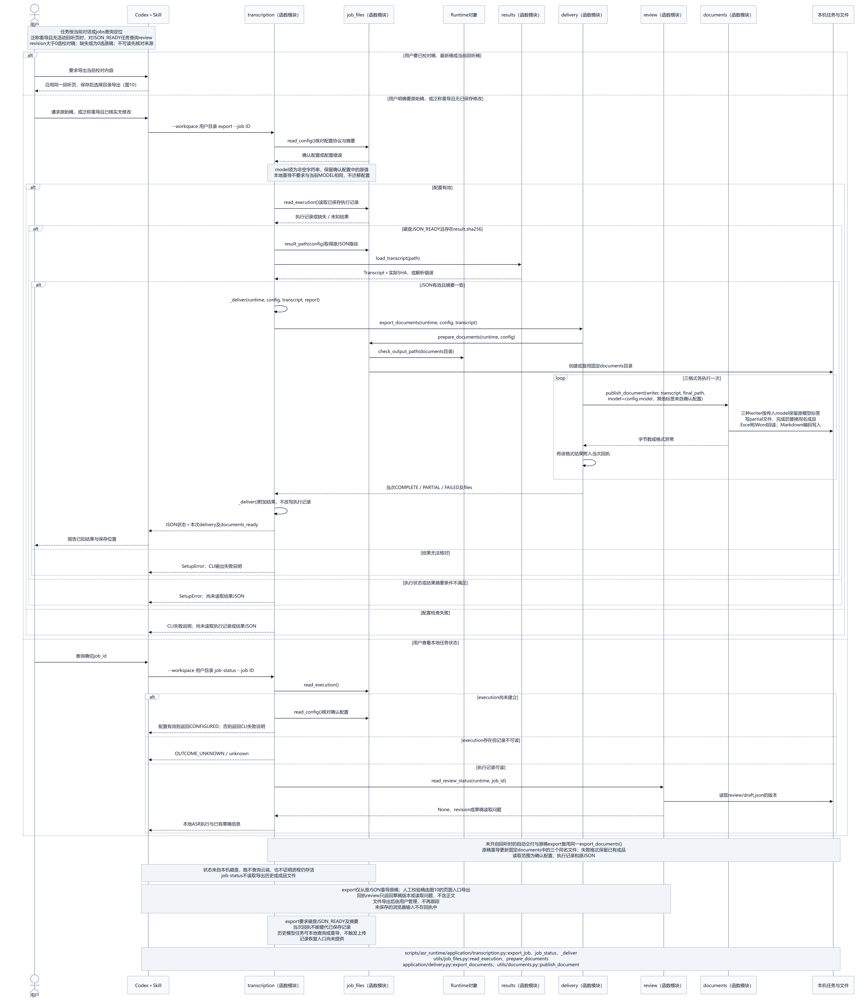

### 07 转写流程（泳道）

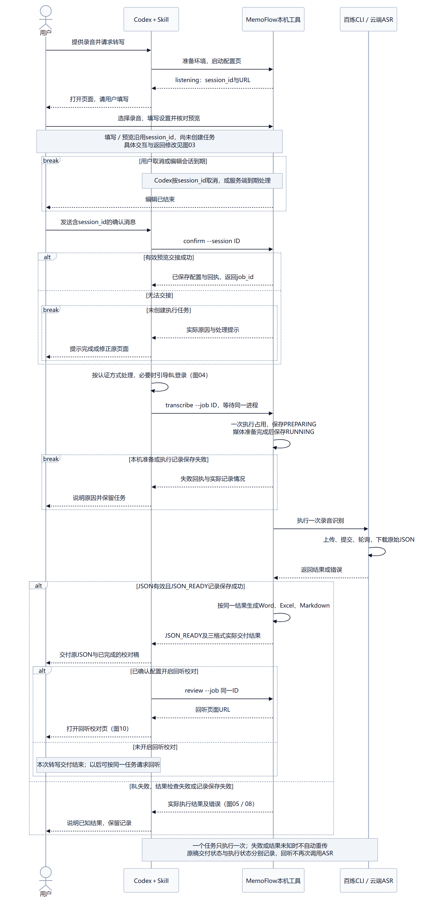

编辑取消/到期不进入ASR；交接后每个job保留一次执行占用。成功JSON记录保存后，原稿交付独立完成或报告部分失败。最后的回听判断只读取已确认配置，不再次询问或授权；开启时沿用同一job_id打开图10的独立回听流程。详细失败回执和磁盘记录的区别见图08。

原稿交付先记录EXPORTING，三格式全部READY时为COMPLETE，部分成功为PARTIAL，全部失败或输出目录准备失败为FAILED；这些结果不改写执行JSON_READY。导出调用中断或记录保存异常时，当次回执可附OUTCOME_UNKNOWN；读取时，缺少delivery目录返回无交付记录，已有目录但记录无效才合成OUTCOME_UNKNOWN。后者是观测结果，不是额外的持久交付阶段。

### 08 记录保存失败

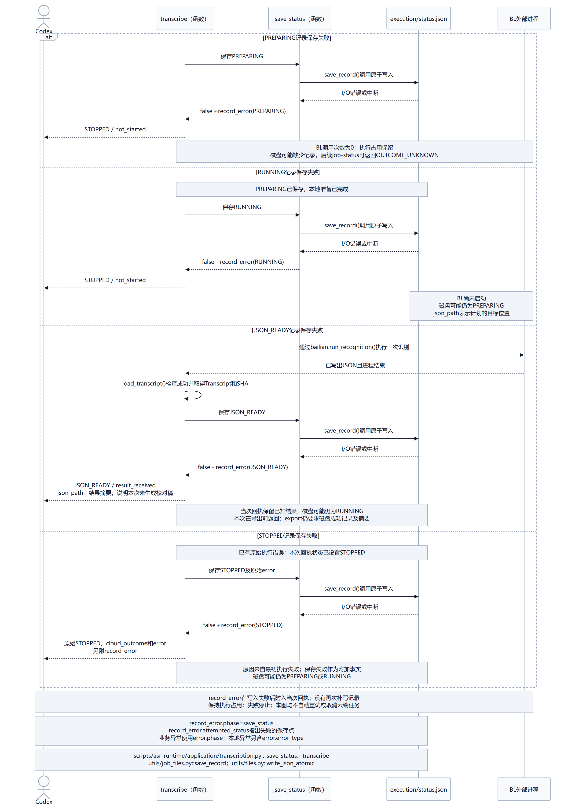

### 09 Skill 自动更新

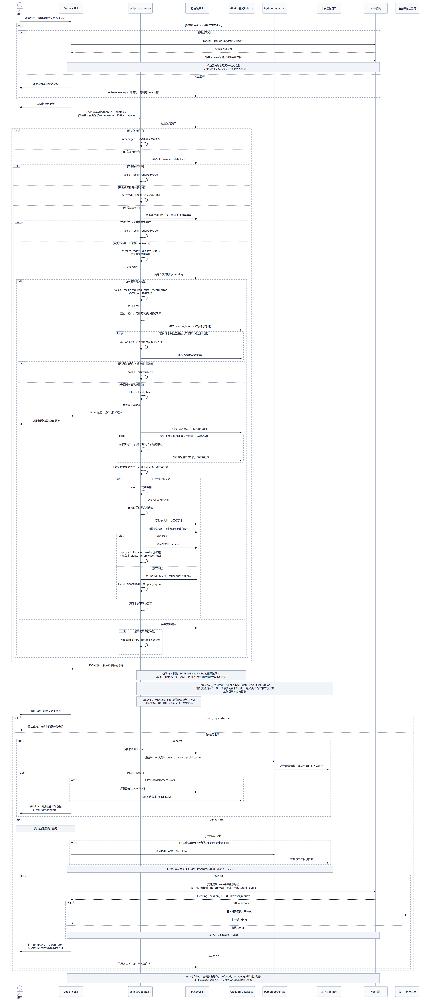

### 10 人工回听与校验稿


### 11 回听与校验稿状态

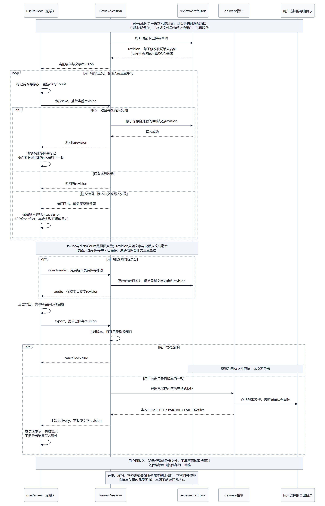
